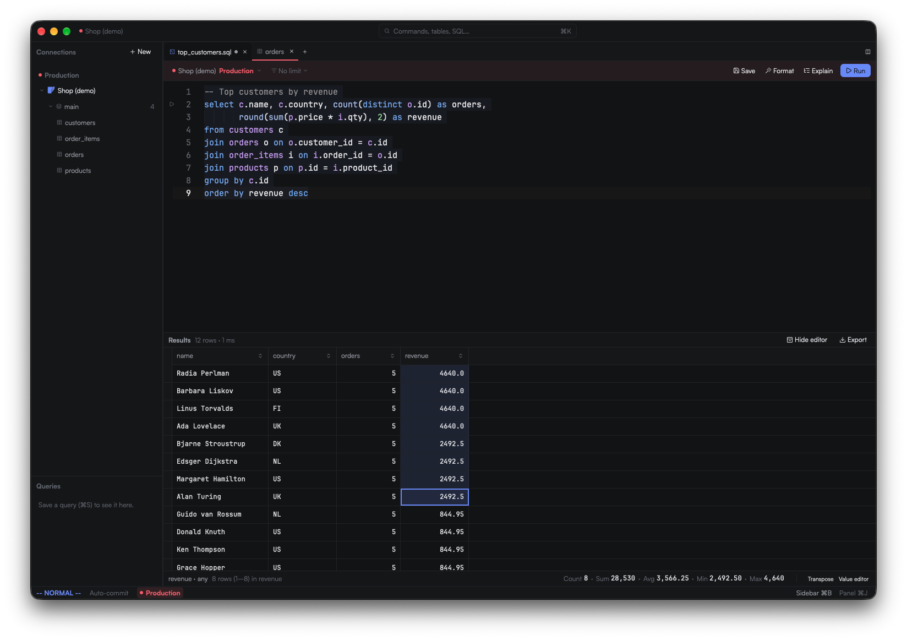
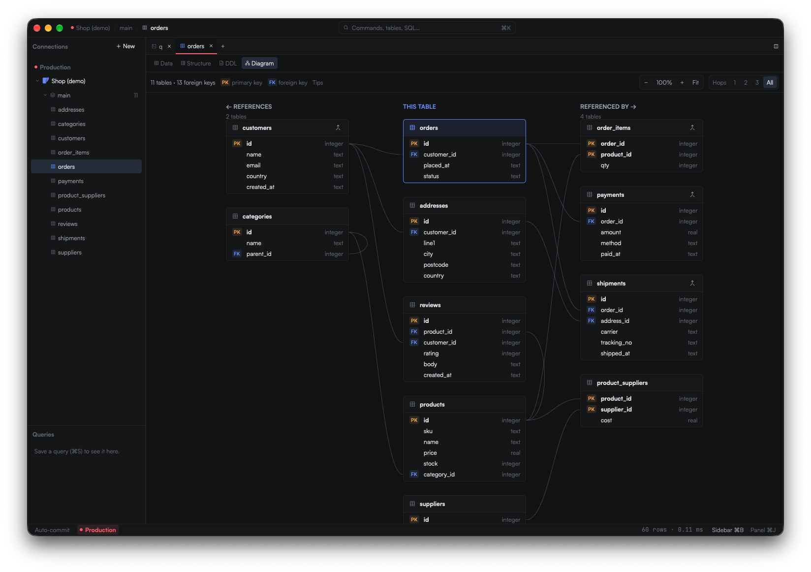
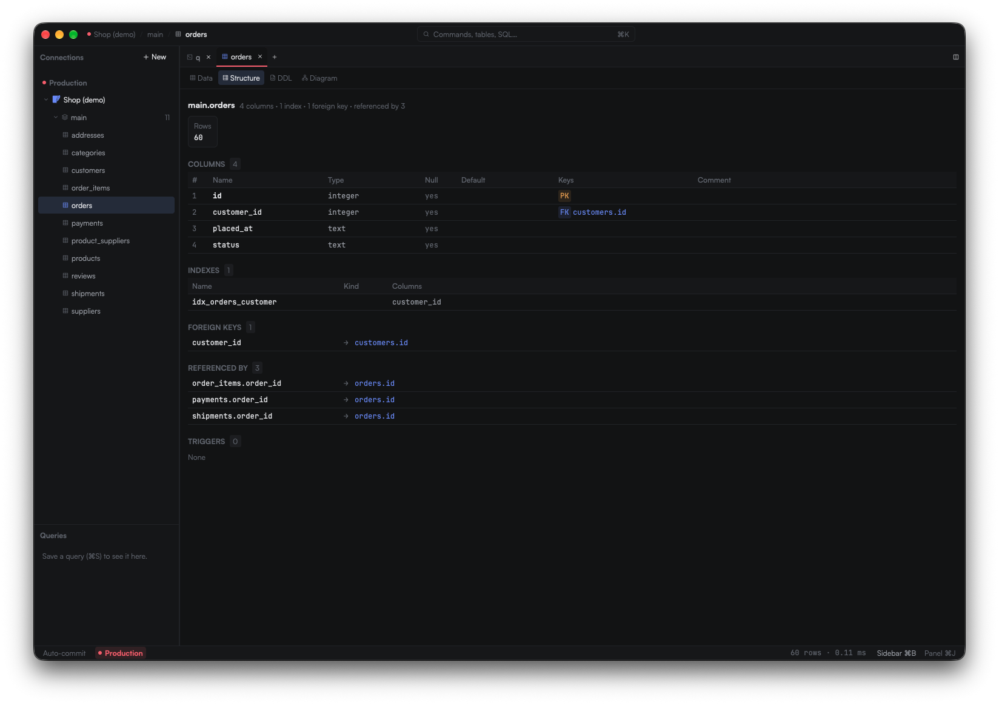
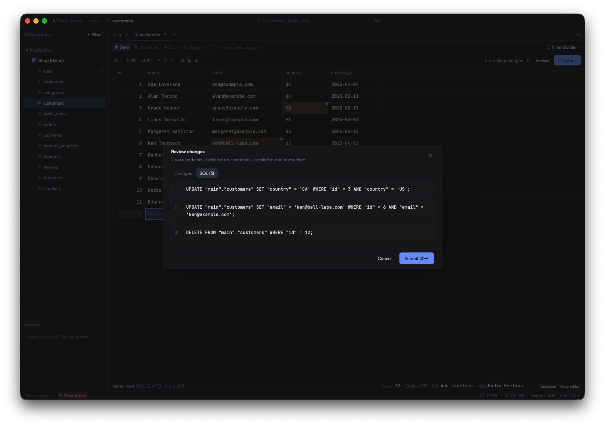
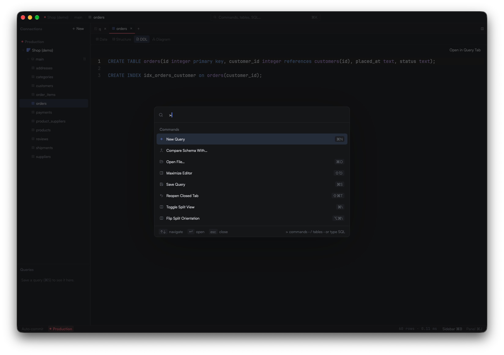

# Quarry

Quarry is a desktop database client written in Rust. It covers the parts of DataGrip I use day to day (writing queries, browsing tables, editing rows, importing and exporting) without the rest of the IDE.

It's in early beta. Expect rough edges, and please open an issue when you hit one.



## What it does

- SQL editor with schema-aware autocomplete, formatting, `EXPLAIN` plans and an optional Vim mode
- Table browser with a data grid, structure and DDL views, and an ER diagram
- Row editing that shows the generated `UPDATE` / `INSERT` / `DELETE` statements for review before anything is committed
- Filter builder, plus count / sum / average / min / max for the selected cells
- Import and export as CSV or JSON, and dump a whole database to SQL
- SSH tunnels, passwords stored in the system keychain, and connections tagged Local / Staging / Production, where Production asks before running anything that changes data
- A `⌘K` / `Ctrl+K` command bar for every action

Supported databases: PostgreSQL, MySQL, SQLite, SQL Server and Oracle. Oracle needs Oracle Instant Client, which Quarry can download for you from the connection form. To add another engine, see [DRIVERS.md](DRIVERS.md).

## Screenshots

| | |
|---|---|
|  |  |
| **ER diagram** of a table and every table it links to | **Structure** view with keys, indexes, foreign keys and back-references |
|  |  |
| **Review before commit**: see the exact SQL your grid edits will run | **Command bar** (`⌘K`) for every action, table and query |

## Install

**Linux and Windows:** download the `.deb`, `.AppImage` or Windows installer from [Releases](https://github.com/thekodeking/quarry/releases).

**macOS:** there are no prebuilt builds, because distributing them would need an Apple developer certificate. Building it yourself takes a few minutes:

```sh
# Requires the Xcode command line tools (xcode-select --install) and Rust (https://rustup.rs)
git clone https://github.com/thekodeking/quarry && cd quarry
cargo install cargo-packager --locked
cd crates/quarry-app && cargo packager --release -f app
cp -R ../../dist/Quarry.app /Applications/
```

An app you build on your own Mac opens without a Gatekeeper warning.

## Development

```sh
make run     # run the app
make test    # run the tests
make lint    # rustfmt check and clippy
```

The workspace has three crates:

- `crates/quarry-core`: the driver registry, one driver per database, and the shared value and row types
- `crates/quarry-sql`: SQL statement splitting and the autocomplete engine
- `crates/quarry-app`: the user interface, built on [GPUI](https://www.gpui.rs)

### Packaging and releases

Packages are built with [cargo-packager](https://github.com/crabnebula-dev/cargo-packager) and written to `dist/`:

```sh
cd crates/quarry-app
cargo packager --release -f app   # or dmg, deb, appimage, nsis
```

To publish a release, push a tag that matches the version in `Cargo.toml` (for example `v0.1.0`). After approval, the Release workflow builds the Linux and Windows packages and attaches them to a GitHub release.

## License

[GPL-3.0-or-later](LICENSE)
