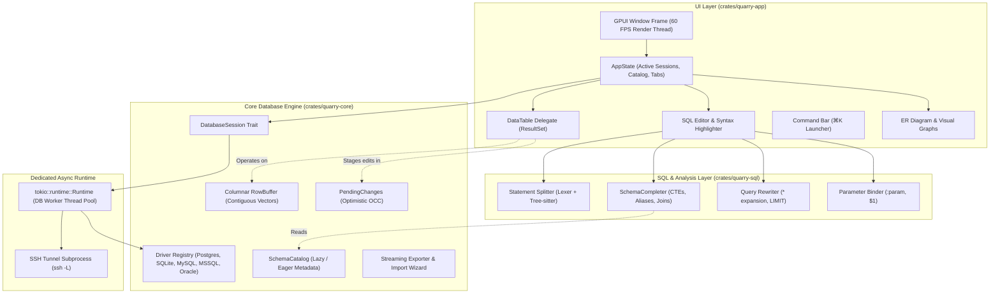
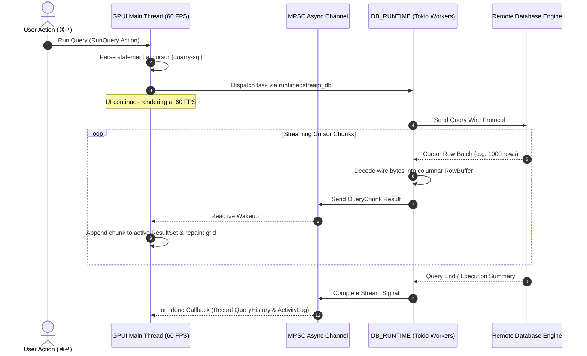
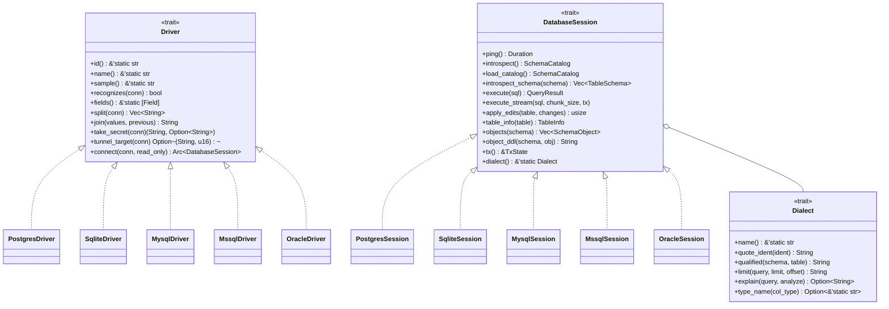
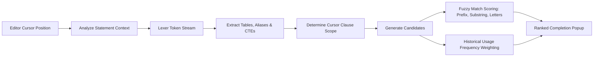

# Quarry Architecture & Internals

> **GitHub Wiki & Architectural Reference**  
> *A comprehensive guide to Quarry's internal architecture, runtime concurrency model, memory representation, and subsystem design.*

---

## Table of Contents

1. [High-Level Architectural Overview](#1-high-level-architectural-overview)
2. [Crate Hierarchy & Responsibilities](#2-crate-hierarchy--responsibilities)
3. [Concurrency, Threading & Runtime Isolation](#3-concurrency-threading--runtime-isolation)
4. [Data Storage & Memory Layout: The Columnar RowBuffer](#4-data-storage--memory-layout-the-columnar-rowbuffer)
5. [Database Session & Driver Subsystem](#5-database-session--driver-subsystem)
6. [SQL Lexing, Splitting & AST-Aware Completer](#6-sql-lexing-splitting--ast-aware-completer)
7. [Transactional Mutation Review & Staged Changes](#7-transactional-mutation-review--staged-changes)
8. [Streaming Query Execution & Cursors](#8-streaming-query-execution--cursors)
9. [UI Layer & GPUI Integration](#9-ui-layer--gpui-integration)
10. [Configuration, Keychain & Security Boundaries](#10-configuration-keychain--security-boundaries)

---

## 1. High-Level Architectural Overview

Quarry is architected to eliminate GUI lag while providing IDE-grade database interactions. Unlike traditional Electron- or JVM-based database clients that incur substantial memory footprints and rendering overhead, Quarry is built directly on native Rust primitives and GPU-accelerated rendering.



---

## 2. Crate Hierarchy & Responsibilities

The codebase enforces strict separation of concerns through three primary workspace crates:

### 1. `quarry-core` (`crates/quarry-core`)
The engine-agnostic foundation layer containing zero UI dependencies.
- **Traits:** `DatabaseSession`, `Driver`, `Dialect`, `Dumper`, `Monitor`.
- **Value System:** `DbValue` enum for lossless scalar representation across engines.
- **Data Engine:** `RowBuffer` contiguous columnar storage with permutation sorting.
- **Catalog Model:** `SchemaCatalog`, `TableSchema`, `ColumnSchema`, `ForeignKeyRef`.
- **Staging & OCC:** `PendingChanges`, `PendingCellEdit`, `PendingRowInsert`, `PendingRowDelete`.
- **Pipelines:** Streaming CSV/JSON export (`Exporter`), import engine (`parse_csv`, type inference), whole-database SQL dumps, and live schema diff generation (`diff`).

### 2. `quarry-sql` (`crates/quarry-sql`)
The language and static analysis layer.
- **Lexical Analysis:** Leverages `quarry-core` zero-copy token spans (`SqlLexer`).
- **Splitting:** Semicolon delimiter parsing that correctly respects quotes, comments, dialect-specific rules (MySQL `#`, SQL Server `GO` batches, Oracle PL/SQL `/` blocks), and Tree-sitter fallback parsing.
- **Intelligent Autocomplete:** `SchemaCompleter` resolves table references, common table expressions (`WITH ...`), subquery projections, foreign-key join hints, and intelligent alias names.
- **Usage Ranking:** Ranks completion candidates using historical identifier execution frequencies.
- **Linting:** Detects referenced tables and columns missing from the active catalog.
- **Rewrites & Code Actions:** `*` wildcard expansion, safe `LIMIT` injection, and transaction wrapping.

### 3. `quarry-app` (`crates/quarry-app`)
The desktop presentation layer built with [GPUI](https://www.gpui.rs).
- **GPU-Accelerated Rendering:** Smooth 60fps desktop rendering with custom component themes.
- **Worker Runtime Isolation:** Tokio runtime (`DB_RUNTIME`) orchestrating all network and disk I/O.
- **Window & Layout Management:** Flexible tabs, splits, collapsable sidebars, and bottom panel drawers.
- **Data Grid:** Virtualized, editable data table supporting keyboard navigation, cell selection ranges, and real-time aggregate statistics.
- **Diagrams:** Interactive ER relationship view with multi-hop neighbor expansion and animated bezier wires.
- **System Integration:** Encrypted passwords via OS keychain (`keyring`), SSH subprocess tunnels, and `.config/quarry` persistence.

---

## 3. Concurrency, Threading & Runtime Isolation

### The UI / Background Thread Boundary

Desktop database tools frequently stutter when network requests, large result decodes, or schema introspections block the UI thread. Quarry solves this with complete thread isolation:



1. **GPUI Main Thread:** Dedicated solely to layout, user input handling, and GPU rendering.
2. **Dedicated Tokio Pool (`DB_RUNTIME`):**
   ```rust
   pub static DB_RUNTIME: std::sync::LazyLock<tokio::runtime::Runtime> =
       std::sync::LazyLock::new(|| {
           let workers = std::thread::available_parallelism()
               .map_or(4, |n| n.get().clamp(4, 16));
           tokio::runtime::Builder::new_multi_thread()
               .worker_threads(workers)
               .enable_all()
               .build()
               .expect("failed to start DB runtime")
       });
   ```
3. **Communication Primitives:**
   - Single-shot async tasks utilize `runtime::run_db(window, cx, future, on_done)`.
   - Continuous streaming queries utilize `runtime::stream_db(window, cx, future_factory, on_chunk, on_done)` with bounded Tokio MPSC channels (depth: 64 chunks).

---

## 4. Data Storage & Memory Layout: The Columnar RowBuffer

Traditional database clients load results as row-major arrays of heap-allocated vectors:
```rust
// Traditional row-major representation (High heap overhead):
Vec<Vec<DbValue>> // 100,000 rows × 20 cols = 2,000,000 heap allocations
```

For large results (e.g. Quarry's default cap of 100,000 rows), this causes extreme memory fragmentation, high GC/allocator pressure, and poor CPU cache locality during column scrolling and cell sorting.

### Quarry's Columnar Buffer (`RowBuffer`)

Quarry represents results in column-major orientation:

```rust
pub struct RowBuffer {
    row_count: usize,
    columns: Vec<Vec<DbValue>>,
    order: Option<Vec<usize>>,
}
```

```
RowBuffer Memory Layout:
Columns:
  Col 0 [ID]:       [ 101, 102, 103, 104, 105, ... ] (Contiguous vector in memory)
  Col 1 [Email]:    [ "a@ex.com", "b@ex.com", ... ] (Contiguous vector in memory)
  Col 2 [Balance]:  [ 42.50, 19.00, 99.95, ... ]    (Contiguous vector in memory)

Permutation Sorting (Zero-Copy):
  Order Vector:     [ 4, 1, 0, 3, 2, ... ] (Maps display_row -> physical_row)
```

### Key Advantages:
1. **Minimal Allocations:** A 100,000-row result with 15 columns requires only 15 primary vector allocations rather than 100,000.
2. **Zero-Copy Sorting:** Sorting by column `k` calculates a lightweight permutation vector (`Vec<usize>`). The actual data rows are never moved or cloned.
3. **Cache-Friendly Aggregates:** Computing column sums, averages, min/max scans a single contiguous vector sequentially in memory.

---

## 5. Database Session & Driver Subsystem

The driver architecture uses an object-safe trait contract allowing the UI to remain database-agnostic.



### Driver Registration & Auto-Detection
Drivers are registered in `crates/quarry-core/src/driver.rs` behind feature flags. When a user pastes a connection string into the connect form, Quarry iterates through `quarry_core::drivers()` calling `Driver::recognizes` in priority order (PostgreSQL → MySQL → MSSQL → Oracle → SQLite).

### Lazy Schema Introspection
When connecting to massive enterprise instances containing thousands of schemas and tables, eager loading degrades performance. Quarry checks `EAGER_SCHEMAS`:
- If total schema count $\le 8$, the full catalog is eagerly loaded.
- If total schema count $> 8$, Quarry loads only the default active schema into `SchemaCatalog`, marking the rest as `unloaded`. Schemas are loaded on demand when expanded in the sidebar.

---

## 6. SQL Lexing, Splitting & AST-Aware Completer

Quarry's SQL intelligence is implemented in `quarry-sql` and backed by `quarry-core`'s zero-copy `SqlLexer`.

### Multi-Stage Statement Splitting
Splitting raw editor text into individual statements requires dialect awareness:
1. **Quotes & Escapes:** Correctly handles single quotes (`'string'`), escaped quotes (`\'`), double-quoted identifiers (`"col"`), MySQL backticks (`` `col` ``), and PostgreSQL dollar-quoted strings (`$$...$$`, `$tag$...$tag$`).
2. **Comment Parsing:** Single-line (`--`, MySQL `#`) and multi-line (`/* ... */`) comments are skipped without interpreting embedded semicolons.
3. **Batch Terminators:**
   - **SQL Server:** Ignores inner semicolons when lines contain batch terminator `GO`.
   - **Oracle:** Preserves semicolons inside PL/SQL blocks (`BEGIN ... END;`), terminating only on solitary slash (`/`) lines.
4. **Tree-sitter Verification:** In complex syntax cases, AST parsing via `tree-sitter-sequel` verifies statement boundaries.

### Autocompletion Pipeline (`SchemaCompleter`)

When typing in the editor, completion candidate extraction follows a 4-phase context resolution:



1. **Scope Determination:** Identifies if the cursor is in a `FROM`/`JOIN` clause, `WHERE` predicate, `SELECT` column projection, or `GROUP BY` clause.
2. **CTE & Subquery Inference:** Parses active `WITH cte_name AS (...)` expressions and subqueries in `FROM (SELECT ...) alias` to extract virtual output columns.
3. **Smart Join Generation:** When completing a `JOIN`, inspects foreign-key definitions in the catalog and offers pre-filled join conditions (e.g. `JOIN orders ON orders.customer_id = customers.id`).
4. **Scoring & Tie-Breaking:**
   - **Score 0:** Exact prefix match.
   - **Score 1:** Substring match.
   - **Score 2:** Acronym or fuzzy letter sequence (e.g. `cid` matches `customer_id`).
   - Equal scores are sorted by historical identifier usage frequencies recorded from previously executed queries.

---

## 7. Transactional Mutation Review & Staged Changes

A signature feature of Quarry is **safe data editing**. Edits made in the data grid never execute raw, blind `UPDATE` queries directly against the database.

### Optimistic Concurrency Control (OCC) Workflow

```mermaid
sequenceDiagram
    autonumber
    actor User as User in Data Grid
    participant Grid as Data Grid UI
    participant Staging as PendingChanges
    participant Review as ReviewModal (Diff View)
    participant Core as apply_edits()
    participant DB as Remote Database

    User->>Grid: Edits cell (e.g. email: "new@ex.com")
    Grid->>Staging: Record PendingCellEdit (PKs, old_value, new_value)
    Note over Staging: Changes staged in-memory; DB untouched
    User->>Grid: Click Review / Commit (⌘S)
    Grid->>Review: Open ReviewModal
    Review->>User: Display SQL UPDATE preview with old vs new diff
    User->>Review: Click "Submit Changes"
    Review->>Core: session.apply_edits(table, pending_changes)
    Note over Core: Wraps in BEGIN TRANSACTION
    loop For each edited row
        Core->>DB: UPDATE table SET col = new WHERE pk = id AND col = old
        DB-->>Core: Check Rows Affected
        alt Rows Affected == 1
            Note over Core: Success
        else Rows Affected != 1
            Core->>DB: ROLLBACK
            Core-->>Review: Err(DbError::ConcurrentModification)
            Note over User: Warns user: row modified by another client
        end
    end
    Core->>DB: COMMIT
    Core-->>Grid: Success (Clear pending edits & refresh)
```

1. **Cell Staging:** Every edit captures:
   - Primary key vector: `RowKey = Vec<(String, DbValue)>`
   - Column name modified
   - Snapshot of `old_value`
   - Entered `new_value`
2. **Review Dialog:** The user inspects the exact dialect-quoted SQL statements that will be run.
3. **Optimistic Locking:** The generated `UPDATE` clause includes `AND col = old_value` in its `WHERE` predicate. If another client changed or deleted that row in the interim, 0 rows are affected. Quarry immediately aborts the transaction with `DbError::ConcurrentModification` to prevent silent data overwrites.

---

## 8. Streaming Query Execution & Cursors

For large result sets, holding the entire result in memory before rendering causes UI freezes.

- **Streaming Cursors:** Drivers implement `execute_stream(sql, chunk_size, tx)` using backend wire-level cursors or pipelined portals.
- **Chunk Size:** Configured via `STREAM_CHUNK_SIZE` (default: 1,000 rows).
- **Interactive UI Updates:** As chunks arrive over the Tokio channel, `ResultSet` appends incoming columnar buffers to its active `RowBuffer` and notifies GPUI to repaint the table.
- **Memory Safety Cap:** Query execution respects `MAX_ROWS` (100,000 rows). Results exceeding this cap flag `truncated() = true` while preserving total `rows_affected`, advising the user to page with `LIMIT` or use the streaming export tool.

---

## 9. UI Layer & GPUI Integration

Quarry's UI is written on [GPUI](https://www.gpui.rs), Zed's high-performance 2D GUI library.

```
Window Root (QuarryWindow)
├── Titlebar & WindowChrome (Window actions, environment badge, connection picker)
├── Main Workspace (h_resizable split)
│   ├── Left Sidebar (Connections, Schemas, Tables, Views, Triggers, Functions)
│   └── Central Workspace (v_resizable split)
│       ├── Active Tab Strip (Query Tabs, Table Tabs)
│       ├── Tab View Content:
│       │   ├── QueryTab: QueryEditor (Code actions, gutter run buttons)
│       │   │   └── Split Pane: DataTable<ResultSet> / PlanView (Tree EXPLAIN)
│       │   └── TableTab:
│       │       ├── TableView::Data (DataTable + FilterBuilder + ValueEditor)
│       │       ├── TableView::Structure (Columns, Keys, Indexes, Comments)
│       │       ├── TableView::Ddl (Colorized CREATE TABLE script)
│       │       └── TableView::Diagram (ER Diagram with foreign-key bezier wires)
│       └── Bottom Panel (Collapsible drawer: Messages, History, Activity Log, Server Monitor)
└── Overlay Stack (CommandBar, AddConnModal, ReviewModal, ExportDialog, ImportWizard)
```

### Virtualized Grid Rendering
The table view utilizes virtualized scrolling: only visible rows and columns are measured and painted during each 60fps frame, allowing instant navigation across 100k-row datasets.

### Reactive State Flow
All UI updates flow through GPUI's `Entity` and `Context` patterns. When background futures complete on Tokio threads, they post closures back to the GPUI context using `cx.spawn_in(...)` and trigger granular repaints with `cx.notify()`.

---

## 10. Configuration, Keychain & Security Boundaries

### Connection Storage & Keychain
- **Non-sensitive Metadata:** Connection profiles are stored in human-readable JSON format at `~/.config/quarry/connections.json` (or `$XDG_CONFIG_HOME/quarry/connections.json`).
- **Passwords & Secrets:** Database passwords and SSH credentials are never written to disk in plain text. Drivers extract secrets via `Driver::take_secret` and store them directly in the OS credential vault (macOS Keychain, Linux Secret Service, Windows Credential Manager) via the `keyring` crate.

### Environment Tagging & Safeguards
Each connection profile is assigned an `Environment`:
- `Environment::Local`: Development databases; immediate execution.
- `Environment::Staging`: Pre-production databases; standard safety.
- `Environment::Prod`: Production databases. Any statement detected as a data modification (`is_mutation(...)` returning true for `UPDATE`, `DELETE`, `DROP`, `TRUNCATE`, `ALTER`) halts execution and prompts the user with an explicit confirmation modal displaying the target server and mutation text.

### Secure SSH Tunneling
For databases behind firewalls or VPCs, Quarry establishes native encrypted tunnels using the host's `ssh` client binary:
- Binds a dynamic local ephemeral TCP port.
- Spawns background process `ssh -N -L <local_port>:<db_host>:<db_port> <user>@<bastion>`.
- Redirects connection driver endpoints through the local port.
- Drops the subprocess cleanly upon session termination.
